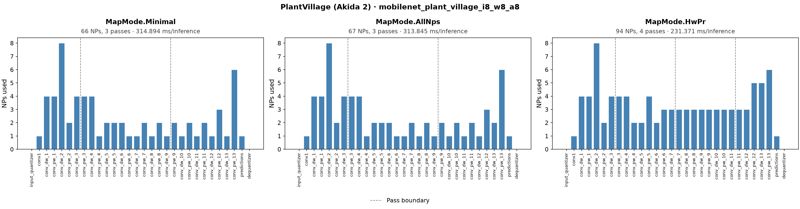
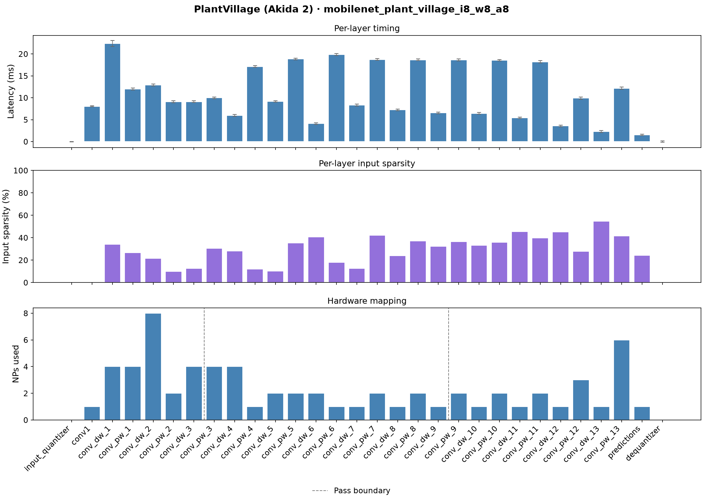
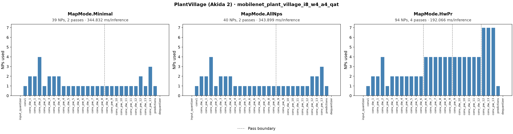
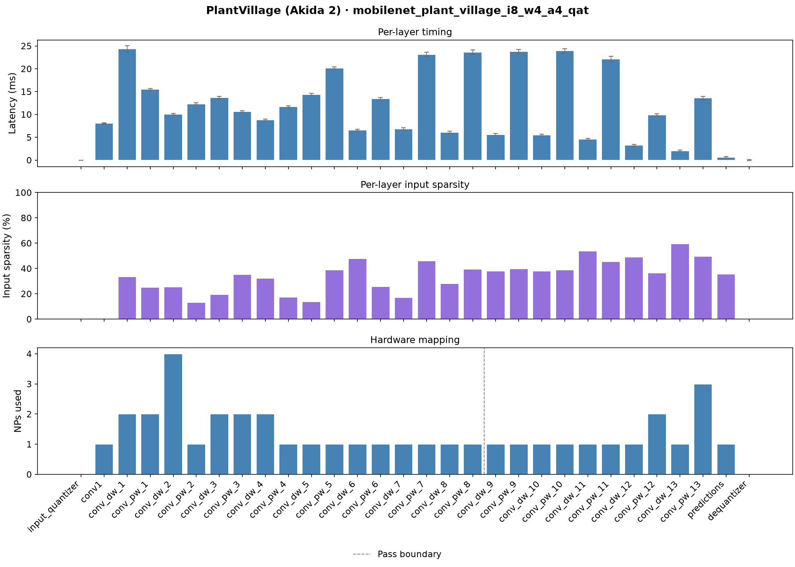
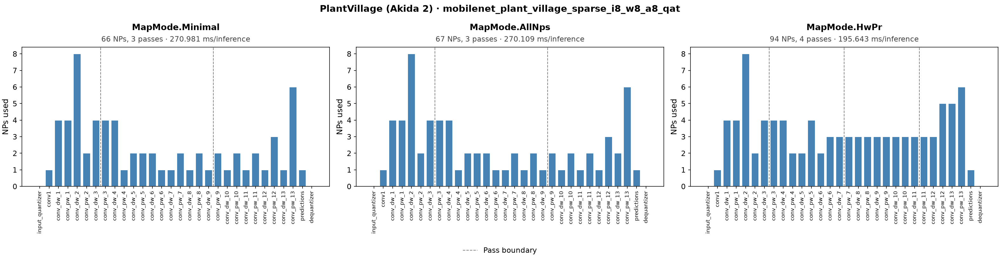
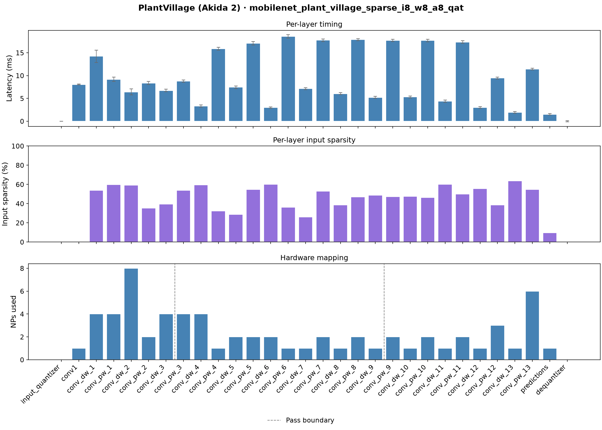
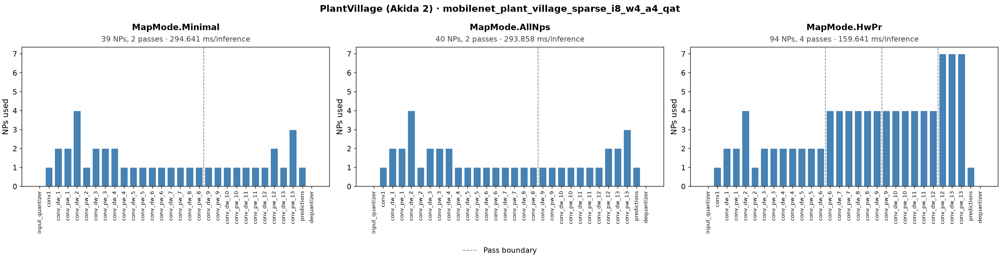
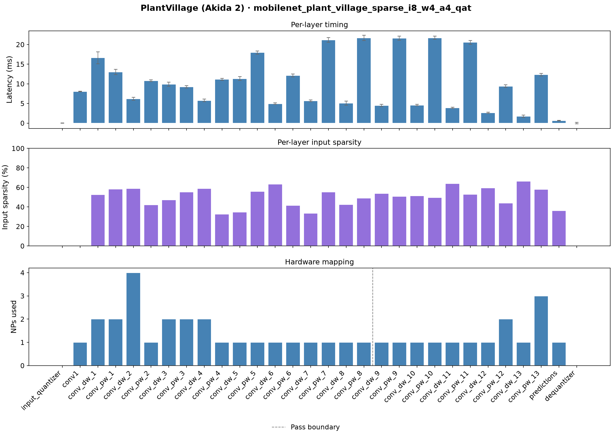

# PlantVillage Disease Classification — Akida 2

## Model Card

Float accuracy: **99.61%** &nbsp;|&nbsp; Parameters: **849,030**

The dense 8-bit and 4-bit variants below share the same float backbone; the sparse
variants share a second, regularized one (see [Sparse variants](#sparse-variants)). On Akida 2 the
model is quantized with **`quantizeml`**: 8-bit weights and activations need no
quantization-aware training (QAT), while a lower-precision 4-bit variant (4-bit
weights and activations, 8-bit input layer) uses QAT to recover accuracy — 4-bit
PTQ accuracy is poor, so only the QAT result is reported.

<table>
  <thead>
    <tr>
      <th>Variant</th>
      <th>Weights / Acts</th>
      <th>QAT</th>
      <th>Quantized acc.</th>
      <th>Akida acc.</th>
      <th>Sparsity</th>
    </tr>
  </thead>
  <tbody>
    <tr>
      <td>8-bit</td>
      <td align="center">w8 / a8</td>
      <td align="center">-</td>
      <td align="center">99.43%</td>
      <td align="center">99.43%</td>
      <td align="center">29.04%</td>
    </tr>
    <tr>
      <td>4-bit</td>
      <td align="center">w4 / a4</td>
      <td align="center">yes</td>
      <td align="center">98.97%</td>
      <td align="center">98.97%</td>
      <td align="center">33.69%</td>
    </tr>
    <tr>
      <td>8-bit sparse</td>
      <td align="center">w8 / a8</td>
      <td align="center">yes</td>
      <td align="center">99.28%</td>
      <td align="center">99.28%</td>
      <td align="center">45.03%</td>
    </tr>
    <tr>
      <td>4-bit sparse</td>
      <td align="center">w4 / a4</td>
      <td align="center">yes</td>
      <td align="center">97.88%</td>
      <td align="center">97.88%</td>
      <td align="center">48.90%</td>
    </tr>
  </tbody>
</table>

**Akida 2 hardware benchmark (FPGA @ 25 MHz)**

Latency is measured on the Akida 2 FPGA reference platform, which runs at
**25 MHz**. A projected latency at a higher target clock is also shown to
indicate expected performance on faster silicon. The cycle count is fixed for a
given model and mapping regardless of clock rate, so the projection is an exact
rescale of the measured cycles.

> **Note:** the projected clock is BrainChip's current **target** for AKD2500 production
> silicon — that silicon does not exist yet, so treat this as a target rather than a
> measured value; it may still change before production. Power measurement on the FPGA
> platform is still under development, so only latency is reported at this time.

<table>
  <thead>
    <tr>
      <th>Variant</th>
      <th>Mapping</th>
      <th>NPs</th>
      <th>Passes</th>
      <th>Cycles</th>
      <th>Latency @ 25 MHz (ms)</th>
      <th>Projected @ 1000 MHz (ms) <i>(target)</i></th>
    </tr>
  </thead>
  <tbody>
    <tr>
      <td rowspan="3">8-bit</td>
      <td>Minimal</td>
      <td align="center">66</td>
      <td align="center">3</td>
      <td align="center">7872358</td>
      <td align="center">314.894</td>
      <td align="center">7.872</td>
    </tr>
    <tr>
      <td>AllNPs</td>
      <td align="center">67</td>
      <td align="center">3</td>
      <td align="center">7846131</td>
      <td align="center">313.845</td>
      <td align="center">7.846</td>
    </tr>
    <tr>
      <td>HwPr</td>
      <td align="center">94</td>
      <td align="center">4</td>
      <td align="center">5784264</td>
      <td align="center">231.371</td>
      <td align="center">5.784</td>
    </tr>
    <tr>
      <td rowspan="3">4-bit (QAT)</td>
      <td>Minimal</td>
      <td align="center">39</td>
      <td align="center">2</td>
      <td align="center">8620801</td>
      <td align="center">344.832</td>
      <td align="center">8.621</td>
    </tr>
    <tr>
      <td>AllNPs</td>
      <td align="center">40</td>
      <td align="center">2</td>
      <td align="center">8597472</td>
      <td align="center">343.899</td>
      <td align="center">8.597</td>
    </tr>
    <tr>
      <td>HwPr</td>
      <td align="center">94</td>
      <td align="center">4</td>
      <td align="center">4801658</td>
      <td align="center">192.066</td>
      <td align="center">4.802</td>
    </tr>
    <tr>
      <td rowspan="3">8-bit sparse</td>
      <td>Minimal</td>
      <td align="center">66</td>
      <td align="center">3</td>
      <td align="center">6774535</td>
      <td align="center">270.981</td>
      <td align="center">6.775</td>
    </tr>
    <tr>
      <td>AllNPs</td>
      <td align="center">67</td>
      <td align="center">3</td>
      <td align="center">6752715</td>
      <td align="center">270.109</td>
      <td align="center">6.753</td>
    </tr>
    <tr>
      <td>HwPr</td>
      <td align="center">94</td>
      <td align="center">4</td>
      <td align="center">4891084</td>
      <td align="center">195.643</td>
      <td align="center">4.891</td>
    </tr>
    <tr>
      <td rowspan="3">4-bit sparse (QAT)</td>
      <td>Minimal</td>
      <td align="center">39</td>
      <td align="center">2</td>
      <td align="center">7366025</td>
      <td align="center">294.641</td>
      <td align="center">7.366</td>
    </tr>
    <tr>
      <td>AllNPs</td>
      <td align="center">40</td>
      <td align="center">2</td>
      <td align="center">7346439</td>
      <td align="center">293.858</td>
      <td align="center">7.346</td>
    </tr>
    <tr>
      <td>HwPr</td>
      <td align="center">94</td>
      <td align="center">4</td>
      <td align="center">3991030</td>
      <td align="center">159.641</td>
      <td align="center">3.991</td>
    </tr>
  </tbody>
</table>

### Benchmark plots

For each variant, two plots are shown below; click a variant to open them. The
**full-model** plot shows the hardware mapping (NPs used per layer, with pass
boundaries) under each mapping mode (Minimal, AllNPs and HwPr): Minimal mapping
schedules the model onto the fewest NPs required, while AllNPs and HwPr spread
it across more NPs. The **per-layer** plot shows per-layer latency, input
sparsity and NP mapping under Minimal mapping. Akida is event-driven, so a
layer's cost depends on how many non-zero activations it receives; sparsity is
measured on real dataset samples.

<details>
<summary><b>8-bit (w8 / a8)</b></summary>





</details>

<details>
<summary><b>4-bit (w4 / a4, QAT)</b></summary>





</details>

<details>
<summary><b>8-bit sparse (w8 / a8, QAT)</b></summary>





</details>

<details>
<summary><b>4-bit sparse (w4 / a4, QAT)</b></summary>





</details>

The model is a **MobileNet (V1)** with width multiplier **alpha = 0.5** and input
resolution **224 × 224**, using transfer learning from an ImageNet-pretrained
backbone with a single 38-class dense layer as its head.

MobileNet is used rather than AkidaNet because AkidaNet was designed around
Akida 1, where a depthwise-separable convolution is a single fused layer with no
activation between its depthwise and pointwise parts. On Akida 2 the depthwise
convolution is a distinct layer, so it can have its own ReLU, as in every
MobileNet block. That makes its outputs sparse, and the pointwise layers that
consume them process fewer events.

## Requirements

For environment requirements and setup, see the [Requirements](../../../README.md#requirements)
section of the top-level README.

## Dataset

The **PlantVillage** dataset contains 54,303 images of healthy and diseased
plant leaves, divided into **38 categories** by plant species and disease type.
It is a widely-used benchmark for agricultural AI research and edge deployment.

Images cover 14 crop species (including tomato, potato, corn, grape, apple and
others) and up to 26 distinct diseases, plus healthy variants. All images are
RGB photographs of individual leaves against a uniform background, originally
at variable resolutions. For this example they are resized to **224 × 224 RGB**.

The dataset is loaded via TensorFlow Datasets (`plant_village`). It is split as:
- **Train**: 80 % of the full dataset (~43,442 images)
- **Validation**: next 10 % (~5,430 images)
- **Test** (held out): final 10 % (~5,431 images)

Original dataset licensed under CC0 1.0 (public domain):
> J, ARUN PANDIAN; GOPAL, GEETHARAMANI (2019), *"Data for: Identification of
> Plant Leaf Diseases Using a 9-layer Deep Convolutional Neural Network"*,
> Mendeley Data, V1, doi: 10.17632/tywbtsjrjv.1

## Dataset setup

The PlantVillage dataset is downloaded automatically via TensorFlow Datasets
on the first training or evaluation run. The dataset will be stored at the
path you provide with `--data` (default: `./data/plant_village`).

To pre-download the dataset without running training:

```bash
python -c "import tensorflow_datasets as tfds; tfds.load('plant_village', data_dir='./data/plant_village')"
```

If you want to store the dataset on a dedicated data drive, pass the path
explicitly to each script (see `--data` / `-d` in the individual scripts).

### Calibration samples

Quantization with `quantizeml` is calibrated on real data, so a batch of 1024
PlantVillage samples is needed in addition to the dataset itself. A prepared batch is
published on the BrainChip mirror, and both `plant_village_train.sh` and
`plant_village_train_sparse.sh` fetch it into `data/` automatically:

```bash
wget -N https://data.brainchip.com/dataset-mirror/samples/plantvillage/plantvillage_batch1024.npz -P data/
```

The training notebook does not use this file. It builds its samples directly
from the dataset with `get_samples()` from
[plant_village_data.py](plant_village_data.py), so that the process is visible and easy to adapt to
your own data.

## Pipeline

Training produces a float model, then quantizes it with `quantizeml` into
several variants, each converted to Akida format:

| Stage | Description |
|---|---|
| Full-precision | Float32 training from scratch |
| 8-bit quantization | `quantizeml quantize` to 8-bit weights and activations (8-bit input), calibrated on real samples; no QAT required |
| 4-bit quantization | `quantizeml quantize` to 4-bit weights and activations (8-bit input), calibrated on real samples, with QAT fine-tuning — 4-bit PTQ accuracy is poor so only the QAT model is kept |
| Sparse variants | Float fine-tuning from the ImageNet backbone with Hoyer-Square activity regularization (`-reg 2e-6`), then 8-bit and 4-bit quantization, each with QAT without the regularizer |
| Conversion to Akida | Automated conversion of each quantized model to Akida 2 format with `cnn2snn convert` |

### Sparse variants

Akida processes events, the non-zero activations, so a sparser model does less work.
The sparse variants come from a float model trained with an activity regularizer on
every ReLU (Hoyer-Square, `HoyerSquare` in
[brainchip_utils/training_utils.py](../../../brainchip_utils/training_utils.py)), which
pushes activations to zero without shrinking the ones that matter. Both bit widths are
quantized from that one model and fine-tuned with QAT, the 8-bit one included: QAT
was more accurate than post-training quantization here, and post-training
quantization collapsed entirely at stronger regularization.

The QAT itself runs **without** the regularizer. Keeping it during QAT made this model
sparser but cost more accuracy than the 99% target for the 8-bit model allowed, while
the sparsity gained in float training mostly survives QAT without it. The strength
(2e-6) is the one that met that target over three training seeds. With HwPr mapping,
an inference takes **4891084 cycles** on the 8-bit sparse model against
5784264 on the dense one, and 3991030 against
4801658 at 4 bits, where the sparse model gives up some accuracy
(97.88% against 98.97%).

This recipe is what worked for this model, not a general rule: the
[Speech Commands example](../speech_commands) keeps the regularizer through QAT, and
the best way to train sparse Akida 2 models is still being worked out across the model
zoo.

The sparse variants are trained by their own script, `plant_village_train_sparse.sh`
(see [Script](#script)).

## Reference Models

Pretrained models are made available here, within the `pretrained_models/`
folder. However, those are handled using the `git-lfs` package (git large
file storage). For those to be downloaded with the repo, you will need to
set up `git-lfs`. For further instructions, see the
[Trained models](../../../README.md#trained-models) section of the top-level README.

## Usage

### Notebook

Two notebooks are provided that walk through a) preparation of a trained Akida-compatible model and
b) evaluation and benchmarking of that model on Akida.

[plant_village_notebook_training.ipynb](plant_village_notebook_training.ipynb) walks through the 
complete training pipeline end-to-end. It is written to expose and explain the Akida-specific
aspects of the workflow: how the model is constructed for Akida 2 compatibility,
what the quantization constraints mean in practice, and what the conversion
step does. Start here if you want to understand *why* the pipeline is structured
the way it is.

[](https://colab.research.google.com/github/Brainchip-Inc/brainchip_devhub/blob/main/akida2/model_zoo/plant_village/plant_village_notebook_training.ipynb)

[plant_village_notebook_benchmark.ipynb](plant_village_notebook_benchmark.ipynb) walks through 
evaluation of model accuracy on Akida and, if a hardware device is available, covers benchmarking
of model latency.

> **Note:** the hardware benchmark section requires a physical Akida 2 FPGA
> platform with a connected board.

### Script

For straightforward reproduction of the training and evaluation results, run
the full pipeline in one shot:

```bash
bash plant_village_train.sh [DATADIR]
```

The sparse variants (see [Sparse variants](#sparse-variants)) are trained separately:

```bash
bash plant_village_train_sparse.sh [DATADIR]
```

For both scripts, the optional `DATADIR` argument overrides the default dataset
location (`./data/plant_village`).

## Contributing and Maintenance

This README is autogenerated from `docs/README.md.template`
so that the accuracy and hardware benchmark values are written directly 
by the code (via the `metrics.json` file, also in the docs folder).

When the associated model or training pipeline is modified to improve
performance, you should rerun the evaluations of the float and quantized
model versions, plus the hardware benchmark, including the 
`--save-metrics` argument, and then regenerate the README from the template
using `update_readme.py`:
```bash
# Float model
python plant_village_eval.py -l pretrained_models/mobilenet_plant_village.h5 --save-metrics

# 8-bit variant
python plant_village_eval.py -l pretrained_models/mobilenet_plant_village_i8_w8_a8.h5 --save-metrics
python plant_village_eval.py -l pretrained_models/mobilenet_plant_village_i8_w8_a8.fbz --save-metrics
python plant_village_benchmark.py -l pretrained_models/mobilenet_plant_village_i8_w8_a8.fbz --save-metrics

# 4-bit variant (QAT)
python plant_village_eval.py -l pretrained_models/mobilenet_plant_village_i8_w4_a4_qat.h5 --save-metrics
python plant_village_eval.py -l pretrained_models/mobilenet_plant_village_i8_w4_a4_qat.fbz --save-metrics
python plant_village_benchmark.py -l pretrained_models/mobilenet_plant_village_i8_w4_a4_qat.fbz --save-metrics

# Sparse variants (Hoyer-Square regularized, QAT)
python plant_village_eval.py -l pretrained_models/mobilenet_plant_village_sparse_i8_w8_a8_qat.h5 --save-metrics
python plant_village_eval.py -l pretrained_models/mobilenet_plant_village_sparse_i8_w8_a8_qat.fbz --save-metrics
python plant_village_benchmark.py -l pretrained_models/mobilenet_plant_village_sparse_i8_w8_a8_qat.fbz --save-metrics
python plant_village_eval.py -l pretrained_models/mobilenet_plant_village_sparse_i8_w4_a4_qat.h5 --save-metrics
python plant_village_eval.py -l pretrained_models/mobilenet_plant_village_sparse_i8_w4_a4_qat.fbz --save-metrics
python plant_village_benchmark.py -l pretrained_models/mobilenet_plant_village_sparse_i8_w4_a4_qat.fbz --save-metrics

python update_readme.py
```
Then commit the changed files (template, metrics and updated README).

Likewise, if you want to edit the contents of this README, you should
not edit it directly, but instead edit `docs/README.md.template` and 
then regenerate the README using
``` bash
python update_readme.py
```
